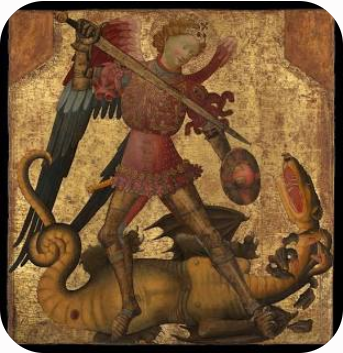

<!-- *** GUIDE START *** -->

::: figure
{width=350px}

<small>San Miguel vence al dragón (The Metropolitan Museum of Art)</small>
:::

## 1. Los demonios, ángeles caídos

Ya vimos que Dios "creó los cielos", es decir el mundo espiritual, los ángeles. Les propuso una vida de felicidad en el amor pero algunos ángeles se amaron más a sí mismos que a Dios y le rechazaron. Se creyeron como Dios, pensaron que tenían suficiente conocimiento y poder y que ya no lo necesitaban. Pero sin Dios solo encontraron frustración e infelicidad. Fueron expulsados del cielo, de la presencia de Dios, para siempre. En la Biblia, en Apocalipsis 12, aparece como el Arcangel San Miguel, fiel a Dios, los combatió y los arrojó del cielo. 

Son seres espirituales libres, libres de tentar a los hombres para que sigan el mismo camino de ellos, pero solo pueden obrar hasta los límites que les marca Dios. Y es un dato de "Fe" que Dios no le permite que nos tienten por encima de nuestras fuerzas. Una santa decía gráficamente que el demonio es un perro atado, solo puede morder a los que se le acercan.

### Actividad

::: activity

**1)** Contacto con la Biblia: Busca y copia dos de los pasajes de la Biblia que se muestran abajo:

- La expulsión de los ángeles caídos (Apocalipsis 12:7-9)
- La caída por soberbia y orgullo (Isaías 14:12-14)
- El juicio a los ángeles pecadores (2 Pedro 2:4  o Judas 1:6)
- El límite a la tentación (1 Corintios 10:13)
- Límite del poder de Satanás (Job 1:12)

**2)** Piensa y escribe una respuesta para esta pregunta: ¿Por qué Dios no perdonó a los Ángeles después de su caída y a los hombres si?

:::

## 2. Las tentaciones

El demonio es un ser espiritual, y del mismo modo que nosotros nos podemos comunicar con Dios (también espiritual) sin palabras, sin mover los labios, el también nos puede decir cosas, cosas que aparecen en nuestra mente y que podemos rechazar o seguir. Nos puede traer un recuerdo malo de alguien para intentar que le odiemos, etc. 

El demonio en su odio a Dios, a sí mismo (sabe que ha frustrado su vida por su propia e irrevocable decisión) y a nosotros, busca que nos perdamos como él en el infierno, en el castigo eterno, en la eterna condenación.

Su arma más común es la tentación por que sabe que si cedemos y pecamos luego vamos quedando cada vez más débiles y esclaviados del pecado. Pero solo tienta hasta donde Dios le permite y el arma que tienen los hombres para superar la tentación es la oración. El hombre humilde ora, pide a Dios fuerzas y Dios siempre ayuda. Pero **hay que querer no pecar** con corazón sincero. Y si no se tiene aun ese corazón sincero hay que pedirlo: "Señor haz que tenga deseos de seguirte, de amarte por encima de todo, Señor haz que quiera".

### Actividad

::: activity

*En parejas, lean la situación asignada, respondan las preguntas y piensen cómo aplica el texto leído.*

**1)** Caso 1: El examen fácil

Joaquín no estudió para el examen de Historia. Durante la prueba, nota que su compañero de al lado dejó parte de la hoja al descubierto. En su mente aparece rápido el pensamiento: *"Si te copias nadie se entera, además el profesor toma cosas muy difíciles y no es justo suspender"*. Si cede, sabe que sacará buena nota, pero siente que algo no está bien.

* *a.* ¿Cuál es el "pensamiento o idea" que aparece en la mente de Joaquín para justificar la falta?
* *b.* ¿Qué consecuencia interna (en su libertad o fortaleza) tiene ceder ante esa tentación?
* *c.* ¿Qué acción o pensamiento humilde podría ayudarlo a rechazar esa idea en ese momento?

**2)** Caso 2: El grupo de WhatsApp

Lucía ve que en el grupo del curso están haciendo comentarios burlones sobre una compañera que no está presente. Siente el impulso de sumar un comentario gracioso para caer bien a los demás y no quedar afuera, aunque por dentro sabe que a la chica le dolería mucho si se entera.

* *a.* ¿Qué recuerdo o deseo utiliza la tentación para convencer a Lucía de actuar mal?
* *b.* Según el texto, ¿por qué ceder a este impulso la vuelve "esclava" de la opinión de los demás?
* *c.* ¿Cómo puede Lucía demostrar que "quiere no pecar" en esa situación concreta?

Mira este [video del Papa Francisco](https://www.youtube.com/watch?v=5azVLEbPq6k) y escribe resumidamente las cosas que enseña sobre el diablo.

:::

## 3. Las poseciones diabólicas

Las posesiones en donde el demonio entra en el cuerpo de una persona es un fenómeno raro pero real. Es algo llamativo pero se puede curar con el exorcismo que no es más que echar el demonio en y por el nombre de "Jesús".

Desgraciadamente, menos llamativas y no por eso menos reales son las poseciones que podriamos llamar "epirituales". Es el estado en el que llegan algunos hombres al persistir voluntariamente en el pecado. La curación de esto es más difícil por que requiere la voluntad del hombre de salir del pecado pero este está tan voluntariamente escalvizado que es difícil. Son casos como el de esos judíos que luego de haber visto tantos milagros de Jesús no creen en Él y le odian hasta matarlo.

No hay que persistir en el pecado, no hay que dialogar con el demonio ni con la tentación, hay que huir, y rápido, como cuando sacamos el dedo rápido cuando nos quemamos con fuego.

Si sabes que llendo a tal lugar, o con tales amigos (que no son amigos) terminas mal, pués evítalo. Así conseguirás paz en esta vida y luego la felicidad en la vida eterna.

### Actividad

::: activity

Elegir y realizar una de las siguientes actividades:

**1)** Completen la siguiente tabla identificando lugares, situaciones o vínculos de fuego" y diseñen la "vía de escape" (huir a tiempo). La primera fila es un ejemplo.

| Situación / Entorno de riesgo ("El Fuego") | ¿Por qué es un peligro persistente? | ¿Cómo se "huye a tiempo" (Acción concreta)? |
| --- | --- | --- |
| Permanecer solo con el celular a altas horas navegando en sitios o redes que generan adicción o violencia. | Al estar cansado y solo, las defensas bajan y se vuelve un hábito fácil de repetir. | Dejar el dispositivo fuera de la habitación y establecer horarios de corte. |
| Un grupo de conocidos que presiona para consumir sustancias o hacer vandalismo. |  |  |
| Mantener una relación donde te piden demostrar "lealtad" haciendo daño a otros. |  |  |

2da fila: Te expone a perder el control y debilita tu capacidad de decir "no" | Poner un límite claro, cambiar de ámbito o no asistir a reuniones donde sabés que ocurrirá.
3era fila: Se disfraza de amistad, pero en realidad es una esclavitud manipuladora. |  Cortar el diálogo, buscar apoyo en adultos de confianza y cambiar de aire.

Mira este [fragmento de video](https://www.youtubetrimmer.com/view/?v=NxFemHMaSJE&start=657&end=939&loop=0) en donde un especialista habla sobre las poseciones diabólicas corporales. Anota al menos tres manifestaciones que aparecen en las poseciones y que permiten diferenciarlas de enfermedades mentalales.

:::

::: warning

Para aprobar esta guía debes mostrarla completa y explicar bien un punto que tu elijas.

:::

<!-- *** GUIDE END *** -->

<!-- *** GUIDE AUXILIARY THINGS *** -->

<!--

● Sections: example, activity. solutions, figure, warning, note

::: example
### Ejemplo: Cálculo de derivadas
Aquí va el contenido de tu ejemplo. Puedes usar Markdown normal adentro.
:::

● Image:

::: figure
{width=400px}

<small>Pie (Source)</small>
:::

[⌕](../../images/ ) 

● Videos:

 Change XXX to video-id and put time in seconds

 - Yotube with start point: [Mira este momento clave en el video](https://www.youtube.com/watch?v=XXX&t=123s)

 - Youtubetrimmer with start and end point: [Mirá este momento puntual del video](https://youtubetrimmer.com/view/?v=XXX&start=120&end=150&loop=0)

-->
