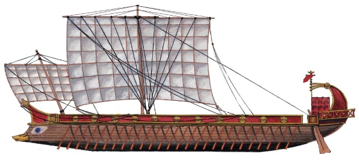

<!-- *** GUIDE START *** -->

::: figure
{width=400px}

<small>Galera Romana (elgrancapitan.org)</small>
:::

El contexto es que Jesús está en Cesarea Marítima, un lugar de paganos, donde había un puerto, y allí trata de hablar y dar fuerzas a los galeotes de una galera romana. 

### Texto a leer

Jesús, arrimado de espaldas a una pared, da verdaderamente la impresión de que estuviera hablando a las olas (...)

—Insensato el hombre que, viéndose poderoso, sano, feliz, dice: "¿De qué tengo necesidad?, ¿de quién? De nadie tengo necesidad. Nada me falta, me basto a mí mismo. Las leyes y decretos de Dios y de la moral, para mí, son nulos. Mi ley consiste en hacer lo que está en mi mano, sin preocuparme de si beneficia o perjudica a los demás. (...) Así hablan el hombre y la mujer que no tienen ni sabiduría ni fe. Con ello muestran su mayor o menor poder, mas denuncian su parentesco con el Mal.

Algunos hombres bajan de la galera y de otras barcas y se dirigen hacia Jesús.

—¡Hola, Maestro! ¿Cómo por aquí? ¿Sabes quién soy?

—Que Dios sea contigo, Publio Quintiliano. ¿Ves como he venido?

—Y además al barrio romano. Ya no tenía esperanzas de volver a verte. Me alegra poder escucharte.

—Yo también me alegro. ¿Hay muchos en los remos en esa galera?

—Muchos. La mayoría son prisioneros de guerra. ¿Te interesan?

—Quisiera acercarme a esa nave.

—Ven.

Jesús reanuda su discurso. El romano, verdaderamente espléndido con el indumento que lleva, parece montar guardia a su lado.

—Esclavos por un doloroso suceso, esclavos mientras dura la vida. Cada una de las lágrimas que cae sobre sus cadenas, cada uno de los golpes descargados sobre sus carnes, afloja los grilletes, abre finalmente para ellos la paz de Dios, que es amigo de sus pobres hijos infelices, a los que dará copiosa alegría, puesto que aquí el dolor abundó. (...) Quiero decirles a estos desdichados amados de Dios que se resignen en su dolor, que hagan de él llama que abra las cadenas de la galera y de la vida, consumiendo en el deseo de Dios este pobre día que es la vida, día oscuro, borrascoso, colmado de miedo y de fatigas, para entrar en el día de Dios, luminoso, sereno, ya sin miedos ni decaimientos. Basta con que sepáis, vosotros, mártires de una penosa suerte, ser buenos en vuestro sufrimiento, basta con que aspiréis a Dios, para que entréis en la gran paz, en la infinita libertad del Paraíso.

»¿Quién es Dios? Estoy hablando (...) a hijos de pueblos sometidos que no saben quién es Dios. En vuestros bosques, vosotros galos, iberos, tracios, germanos, celtas, tenéis sólo una apariencia de Dios (...) Pero no sabéis encontrar al Dios verdadero que ha puesto un alma en vuestros cuerpos, (...) El Dios verdadero es Amor y Piedad. ¿Acaso eran esto vuestros dioses? No. Más bien manifestaban dureza, crueldad, engaño, hipocresía, vicio, ... y ahora os han dejado sin ese mínimo consuelo de la esperanza de ser amados y la certeza del descanso tras tanto sufrimiento. Esto sucede porque vuestros dioses no existen. Sin embargo, Dios, el Dios verdadero que es Amor y Piedad, cuya segura existencia Yo os declaro, es Aquel que ha hecho los cielos, los mares, montes, bosques, plantas, flores, animales... y al hombre; es Aquel que inculca al hombre victorioso la piedad y amor que Él mismo es hacia los pobres de la tierra.

»Y vosotros los poderosos, los dominadores, pensad que sois todos de una única planta. No os ensañéis con aquellos a quienes la desventura ha puesto en vuestras manos; sed humanos con los que por un delito están amarrados al banco de la galera. El hombre peca muchas veces. No hay ninguno exento de culpas... Si pensarais esto, ¡cuán buenos seríais para con los hermanos que, menos afortunados que vosotros, han recibido castigo por culpas en que también vosotros habéis incurrido y que no os han sido castigadas! La justicia humana adolece gravemente de exactitud cuando juzga. (...) Sed humanos, por tanto, vosotros que habéis sido colocados al frente de las galeras. Por encima de la justicia humana hay una Justicia divina que es mucho más alta: la del Dios verdadero, la del Creador del rey y del esclavo, de la roca y del granito de arena. Él os mira, tanto a los que estáis en los remos como a quienes tenéis el encargo de regirlos ¡ay de vosotros si arbitrariamente sois crueles!; Yo, Jesucristo, el Mesías del Dios verdadero, os aseguro que Él, el día de vuestra muerte, os atará al banco de una galera eterna y pondrá en manos de los demonios el látigo ensangrentado y seréis torturados y azotados como vosotros torturasteis; porque, si bien es ley humana el castigo del reo, es necesario no exceder la medida. Sabed recordar esto. Quien hoy es poderoso mañana puede ser un miserable; sólo Dios es eterno.

»Quisiera (...) romper vuestras cadenas, devolveros la libertad y patria perdidas; pero, hermanos galeotes que no veis mi rostro, hermanos galeotes cuyo corazón con todas sus heridas conozco, por la libertad y la patria terrenas que no os puedo dar, ¡oh, pobres esclavos de los poderosos!, os daré una libertad y una patria más altas. Por vosotros me he hecho prisionero, ausente estoy de mi patria, por vosotros me entregaré Yo mismo como rescate; para vosotros, sí, también para vosotros, que no sois oprobio de la Tierra como os llaman, sino signo de vergüenza para el hombre que olvida la medida del rigor de la guerra y de la justicia, haré una nueva ley sobre la Tierra y una dulce morada en el Cielo.

»Recordad mi Nombre, hijos de Dios que lloráis: es el nombre del Amigo. Repetidlo en medio de vuestros padecimientos.

»Estad seguros de que si me amáis me tendréis, aunque no nos veamos jamás en esta Tierra. Soy Jesucristo, el Salvador, el Amigo vuestro. En nombre del Dios verdadero os consuelo. La paz descienda pronto sobre vosotros.

La gente, en su mayoría romanos, se ha agolpado en torno a Jesús, cuyos conceptos nuevos han producido el asombro de todos.

Jesús por su parte le dice (a Publio Quintiliano):

—¿Podría dar a esos galeotes algo que los consolara? Tengo dinero... Fruta, algo que los alivie; para que sepan que los amo.

—Dámelo. Puedo hacerlo... Me ocuparé yo mismo de la distribución, de forma que los esbirros no se aprovechen abusivamente. Será la única vez que un soldado imperial ejercite la piedad con los esclavos de guerra.

—La primera, no la única. Llegará el día en que no habrá esclavos; pero ya antes mis discípulos habrán descendido a los galeotes y esclavos para llamarlos hermanos.

**Fuente:** Revelaciones sobre su vida que Jesús mostró a una mujer italina, María Valtorta (1897-1961), que pasó gran parte de su vida postrada en una cama por ser golpeada en la calle.

### Actividad

::: activity

Copiar al menos dos partes del texto que te hayan llamado más la atención. Explica brevemente porque.

>Para aprobar esta guía debes mostrar completa la parte escrita.

:::

<!-- *** GUIDE END *** -->

<!-- *** GUIDE AUXILIARY THINGS *** -->

<!--

● Sections: example, activity. solutions, figure, warning, note

::: example
### Ejemplo: Cálculo de derivadas
Aquí va el contenido de tu ejemplo. Puedes usar Markdown normal adentro.
:::

● Image:

::: figure
{width=400px}

<small>Pie (Source)</small>
:::

[⌕](../../images/ ) 

● Videos:

 Change XXX to video-id and put time in seconds

 - Yotube with start point: [Mira este momento clave en el video](https://www.youtube.com/watch?v=XXX&t=123s)

 - Youtubetrimmer with start and end point: [Mirá este momento puntual del video](https://youtubetrimmer.com/view/?v=XXX&start=120&end=150&loop=0)

-->
