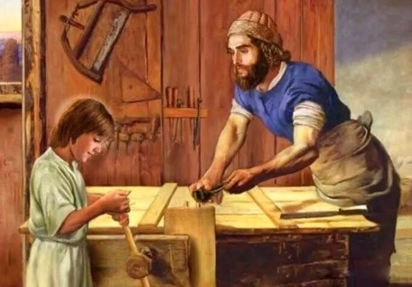

<!-- *** GUIDE START *** -->

::: figure
{width=400px}

<small>San José enseñando a Jesús el oficio (elsellonoticias.com)</small>
:::

### Texto a leer

Jesús está escuchando con atención a una pobre viuda que, entre lágrimas, le narra la muerte repentina de su marido
carpintero, en el banco de trabajo, acaecida pocos días antes:

-Vine corriendo a buscarte aquí. Todo el parentesco del difunto me acusó de falta de compostura. Ahora me maldicen. Pero había venido porque sabía que resucitabas y sabía que si te encontraba mi marido resucitaría. No estabas... Ahora él está en el sepulcro desde hace dos semanas... y yo estoy aquí con cinco hijos... Los parientes me odian y me niegan su ayuda. No tengo dinero, porque mi marido desde hacía tiempo estaba poco sano y trabajaba poco. Estaba terminando un carro y un baúl; pero ahora... no están terminados. Perderé el dinero... El carro y el baúl ni siquiera los puedo vender como tales, aunque estén casi ultimados, así que los voy a tener que dar como leña para el fuego. No va a ser suficiente el dinero, porque yo, mi madre anciana y enferma y cinco hijos somos siete personas ¿qué debo hacer?

-¿Dónde vives?

-En Corazín, junto al camino que va a la Fuente caliente. Una casa baja entre dos higueras.

-Bien. Iré a ultimar el carro y el baúl, de modo que podrás vendérselos a quien los había encargado. Espérame mañana a la aurora.

-¿Tú? ¿Tú trabajar para mí? -La mujer se siente ahogar del estupor.

-Volveré a mi trabajo y te daré paz a ti. Al mismo tiempo, a esos de Corazín sin corazón les daré la lección de la caridad (...).

La mujer se arrodilla a besarle la túnica y se marcha más consolada.

Jesús está trabajando con empeño en un taller de carpintero. Está terminando una rueda. Un niño, menudo y triste, hijo de la viuda, le ayuda acercándole esto o aquello. Junto a la pared hay un banco en que Manahén (un amigo y discípulo de Jesús que es poderoso y tiene muchos bienes), testigo inútil pero maravillado, está sentado. Jesús da ánimos con sonrisas y buenas palabras al niño, y le enseña lo que debe hacer para conseguir que la cola adquiera el punto exacto o que queden bien lustrosas las paredes del baúl.

-Lo has terminado pronto, Maestro -dice Manahén

-¡Estaba casi terminado!...

-Quisiera adquirir esta obra tuya, pero ya ha venido el comprador y parece que tiene sus derechos...

-Déjalo. Además, aquí hay madera, y la mujer se pondrá muy contenta de emplearla para sacar una ganancia. Si me encargas un baúl, te lo hago...

-¡Sí, Maestro! ¿Pero tienes intención de trabajar más?

-Hasta que se acabe le madera. Soy un obrero responsable -dice sonriendo más abiertamente.

-¡Un baúl hecho por ti! ¡Qué reliquia! ¿Y qué voy a meter dentro?

-Lo que quieras, Manahén. No será más que un baúl.

-¡Sí, pero hecho por ti!

-¿Y qué quieres decir con eso?... También el Padre ha hecho al hombre, a todos los hombres, y ¿qué ha metido el hombre dentro de sí?, ¿qué meten en el hombre los hombres?

-Hemos metido el pecado, es verdad.

-¡Pues ya lo ves! Debes creer también que el hombre, creado por Dios, es mucho más que un baúl hecho por mí. 

-Sí, Maestro; pero, ¿me haces el baúl?

-Te lo hago. Ahora bien, dado que lo ves como una reliquia, te lo haré pagar como tal. Al menos se podrá decir que al menos una vez fui codicioso de dinero... Pero tú sabes para quién es ese dinero... Para estos huerfanitos...

-Pídeme lo que quieras. Te lo daré. A1 menos estará justificado mi ocio mientras Tú, Hijo de Dios, trabajas.

-Está escrito: "Comerás tu pan mojado con el sudor de tu frente"

-¿Piensas que Corazín se va a convertir por esta lección silenciosa y santa que estás dando con el trabajo que haces para socorrer a una familia?

-No lo hará. Dirá: "Ha preferido trabajar para engañar al tiempo y para ganarse un dinero". Pero Yo ya no tenía más dinero. Había dado todo. Siempre doy todo lo que tengo, hasta la última moneda, y he trabajado para dar dinero.

Se asoma la viuda y dice:

-La comida está preparada, Maestro. Pero, trabajas demasiado...

-Gano mi pan, mujer. Además... mira, aquí hay otro cliente; quiere también un baúl. Paga bien. El sitio de la madera se te va a quedar vacío -dice Jesús, y va afuera de la habitación para lavarse en una palangana que la mujer le ha puesto en el huerto.

Y ella, con una de esas sonrisas vacilantes que afloran de nuevo tras mucho tiempo de llanto, dice:

-Vacío el sitio de la madera, llena la casa de tu presencia y el corazón de paz. No me da miedo el mañana, Maestro; y Tú no temas jamás que te podamos olvidar.

*Texto adaptado de las revelaciones sobre su vida que Jesús mostró a una mujer italina, María Valtorta (1897-1961), que pasó gran parte de su vida postrada en una cama por ser atacada y golpeada en la calle.*

### Actividad

::: activity

**1)** Une con flechas las palabras con la frase que corresponda:

~~~
Caridad      Objeto que tiene un valor religioso
Estupor      Desobediencia a la ley de Dios
Reliquia     Amor a Dios y al prójimo
Pecado       Asombro grande que desconcierta
~~~

**2)** ¿Quién es Manahén?

**3)** ¿Qué quiere predicar Jesús haciendo este trabajo?

**4)** Anota dos frases que te hayan gustado y explica por qué

:::

>Para aprobar esta guía debes mostrar completa la parte escrita.

<!-- *** GUIDE END *** -->

<!-- *** GUIDE AUXILIARY THINGS *** -->

<!--

● Sections: example, activity. solutions, figure, warning, note

::: example
### Ejemplo: Cálculo de derivadas
Aquí va el contenido de tu ejemplo. Puedes usar Markdown normal adentro.
:::

● Image:

::: figure
{width=400px}

<small>Pie (Source)</small>
:::

[⌕](../../images/ ) 

● Videos:

 Change XXX to video-id and put time in seconds

 - Yotube with start point: [Mira este momento clave en el video](https://www.youtube.com/watch?v=XXX&t=123s)

 - Youtubetrimmer with start and end point: [Mirá este momento puntual del video](https://youtubetrimmer.com/view/?v=XXX&start=120&end=150&loop=0)

-->
